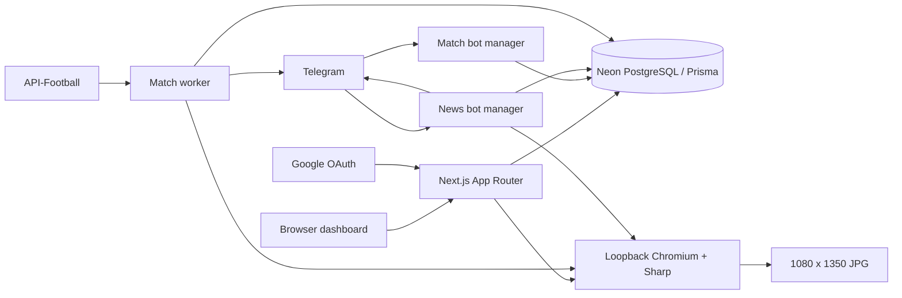

# Final Whistle production audit and controlled cleanup plan

Date: 2026-11-05. Scope: the main project only. The old Codex workspace was neither modified nor used as a source for this audit.

## Conclusion

The existing features work, but passing tests does not establish readiness for unrestricted public, multi-user deployment. **No Critical finding was confirmed. Four High findings remain approval-gated.** These are implementation weaknesses, not evidence of a past compromise.

The completed batch changes development hygiene and documentation only. Runtime logic, authentication behavior, bot conversations/commands, layouts, fonts, and image export are unchanged. No migration, schema/credential change, dependency upgrade, deletion, Git commit, or live service restart was performed.

The audit covered application entry points and boundaries, server actions, Google/password sessions, bot managers and handlers, Prisma models and query patterns, template/file/network boundaries, dependency metadata, repository exposure, deployment scripts, tests, and generated-file organization. It is a source/configuration audit with targeted offline probes and local validation, not a penetration test of Google, Telegram, Neon or the user's network.

## Architecture before and after

- [App Router](../src/app/) holds public pages, protected dashboards, server actions, Google routes, health and News-preview APIs. Authentication occurs in pages/actions. Absence of middleware alone is not a vulnerability.
- [Sessions](../src/lib/auth.ts) use random browser tokens, SHA-256 database hashes, expiry, HttpOnly/SameSite cookies and production Secure flags. [Passwords](../src/lib/password.ts) use salted scrypt and constant-time comparison.
- [Google helpers](../src/lib/google.ts) implement state, PKCE, fixed endpoints, verified-email checking and timeouts. The account-association policy needs H1 below.
- [Match dashboard](../src/app/dashboard/match/page.tsx) combines approximately 700 lines of server UI/actions. Most mutations derive identity through requireUser and check resource ownership. Splitting actions later can improve reviewability without relocating the whole application.
- [News page](../src/app/news/page.tsx), [actions](../src/app/news/actions.ts) and [editor](../src/app/news/template-editor.tsx) separate server persistence and client form state. [Preview API](../src/app/api/news/preview/route.ts) checks session/origin, bounds input and per-user frequency, and removes temporary output.
- [Match manager](../scripts/bot.mjs) and [worker](../scripts/worker.mjs) are long-running Node processes. Selection claiming is atomic, but manager lifetime and startup recovery need H4.
- [News manager](../scripts/news-bot.mjs) has a PostgreSQL advisory lock, renderer-auth/protocol checks and webhook inspection. [Its handler](../scripts/lib/news-core.mjs) adds secure linking and persisted update claims around the original conversation.
- [Shared renderer](../render/render-server.js) owns persistent Chromium and Sharp utilities. [News rendering](../render/news-renderer.js) uses a separate context per job, embedded fonts/images, request blocking, 2160 x 2700 capture and the shared 1080 x 1350 JPEG exporter. News disables grain; Match's existing grain remains unchanged.
- [Prisma schema](../prisma/schema.prisma) separates Match/News configuration and relates resources to users. No production model or database schema was changed.

**After this batch:** the runtime topology is identical. CI installs Chromium, environment variants/compiler caches are ignored, TypeScript excludes generated storage content, and setup/test documentation identifies obsolete instructions. No runtime abstraction or structural reorganization was introduced merely for tidiness.

## High findings — approval required

### H1 — Google/password account pre-hijacking

**Confirmed code path; no real account was attacked.** [Signup](../src/app/signup/page.tsx:23) accepts an email without ownership verification and immediately creates a password account/session. [Google callback](../src/app/auth/google/callback/route.ts:38) reuses an account by verified email without explicit linking, removing an existing password, or revoking prior sessions.

An attacker can register a victim's email first. If that victim later signs in with Google, both can retain access to the same account using different credentials. This does not forge a Google profile; it associates that profile with an unverified existing local account.

**Proposal:** agree on ownership verification/account-linking policy, then test unverified local accounts, legitimate password accounts, legacy accounts, session revocation and Google-only accounts. Any email service or identity-model migration requires separate approval. Do not silently invalidate existing passwords in a cleanup.

### H2 — First-contact takeover of an unlinked Match bot

**Confirmed.** [handleStart](../scripts/bot.mjs:93) associates an unlinked owner's bot with the first chat, without a website-issued one-time proof. Ordinary text/uploads can trigger this path. Private-chat/sender-ID checks are absent; group callbacks rely on chat association rather than individual sender identity.

Someone discovering the bot username before its owner links it can become the recipient of that Match workflow. News already has stronger private-chat and expiring hashed-token checks.

**Proposal:** explicit secure initial Match linking, preserving existing authorized chats and regular commands. This changes initial linking behavior and needs approval plus manual Telegram testing.

### H3 — Incomplete Match renderer trust boundary

**Confirmed implementation weakness; exploitability depends on loopback access or another server-side request path.** [/render](../render/render-server.js:475) is unauthenticated, accumulates an unbounded request body, and interpolates several fields as raw HTML. [HOME_NAME](../render/render-server.js:546), for example, is not escaped. The request guard is only installed for custom templates. Attacker-controlled fields in built-in requests can therefore inject markup/script. Arbitrary logo URLs and background paths also cross this boundary.

The server does bind to 127.0.0.1. This is not a claim that the endpoint is publicly internet-accessible. Nevertheless, a compromised Match render path shares the process/browser host with News.

**Proposal:** coordinated caller authentication, bounded request schemas/concurrency, text escaping with explicit trusted event markup, local-file confinement and safe remote-image policy. Preserve successful output with visual fixtures. Any new secret requirement must be reviewed separately; do not change credentials automatically.

### H4 — Match duplicate-process and recovery hazards

**Confirmed mechanism; no live duplicate was induced.** [The manager](../scripts/bot.mjs:245) uses only an in-process Map. [Polling](../scripts/lib/poller.mjs:50) resets offset on restart and continues after a 409 conflict. [Worker startup](../scripts/worker.mjs:48) resets every SENDING selection through [recoverStuck](../scripts/lib/worker-core.mjs:295). A second worker can reset a job still being sent by the first, defeating the otherwise useful atomic claim.

The deliveredButUnsaved map also cannot survive a process crash. Telegram delivery and database completion are not one atomic operation.

**Proposal:** manager/worker singleton leases, fail-closed lease loss, ownership-aware recovery and conflict shutdown; add second-worker/crash/reconnect tests. Preserve normal commands and notifications. Do not promise exactly-once external delivery.

## Medium findings

| ID | Confirmed evidence or qualification | Proposed response |
|---|---|---|
| M1 | [Match startup](../scripts/lib/poller.mjs:35) unconditionally deletes a webhook, potentially disabling an existing integration. News inspects/refuses instead. | Approval required: inspect and stop, never remove a webhook automatically. |
| M2 | [Website](../src/lib/render.ts:33) and [worker](../scripts/lib/render.mjs:71) background filters omit mapped IPv6 and do not validate resolved addresses or redirects. An offline mocked-fetch probe confirmed mapped loopback reaches fetch. Current UI has no background-URL setter, so exposure is through stored/legacy URLs and internal consumers. [Logo localization](../render/render-server.js:175) is broader still. | One tested network policy covering DNS binding, IP forms, redirects, streaming limits and legitimate hosts. No real private target was contacted. |
| M3 | [Login limiter](../src/lib/password.ts:51) is per-process/per-email with an unbounded key Map. [Signup](../src/app/signup/page.tsx) has no rate limiter/server email-length ceiling. Expensive actions lack a shared budget. | Bounded throttling and request limits appropriate to deployment; approval before auth behavior changes or new infrastructure. |
| M4 | [Telegram downloads](../scripts/lib/telegram.mjs:44) and backgrounds check size after full buffering. Logo downloads have no comparable maximum. News bounds request bytes but not total concurrent browser work. | Bounded streaming and render concurrency, with supported formats and dimensions preserved. |
| M5 | [Assign-to-all](../scripts/bot.mjs:194) shares a background path across selections; [cleanup](../scripts/lib/worker-core.mjs:314) unlinks it without checking newer references or using the dashboard's directory boundary helper. | Reference-aware, directory-confined cleanup. No live file or row was deleted to verify this. |
| M6 | [Fixture-day keys](../scripts/lib/football.mjs:122) begin with utc:, but [cleanup](../scripts/lib/worker-core.mjs:319) compares them to a bare date. Those prefixed rows do not expire as intended. | Confirmed retention bug. Defer: repairing it enables database deletion and needs explicit approval. |
| M7 | CI lacked Chromium installation although News tests launch the real browser. | **Safe fix completed** in [CI](../.github/workflows/ci.yml:29). Hosted CI was not triggered. |
| M8 | [Legacy installer](../INSTALL_NEWS.cmd) performs broad db push; old instructions recommend rerunning it. Production has no _prisma_migrations history, although the reviewed News SQL succeeded and NewsSettings now has ten columns. | Documentation warning added. Retire installer only after approval; separately establish a reviewed migration baseline. No baseline/migration was run. |
| M9 | Completed News integration code, fonts/previews and other files remain untracked; a tracked-files-only deployment can omit them. | Separately review/commit the full intended change set. Nothing staged, committed or pushed. |
| M10 | Both connect flows check cross-generator bot ownership, but unique bot IDs reside in separate tables. Concurrent cross-table registrations could race. | Potential concurrency exposure from confirmed schema structure, not an observed collision. Review serialized application claims before proposing schema changes. |

## Low findings and improvements

- **L1, partly fixed:** environment variants were not ignored. Added .env.* with .env.example retained, plus *.tsbuildinfo. The [compiler cache](../tsconfig.tsbuildinfo) was subsequently removed from Git tracking during the approved small cleanup; its local contents and ignore rule were preserved.
- **L2:** crypto, branding and URL-download logic are duplicated across TS/MJS. Preserve compatibility tests; consolidate small helpers only after agreeing security policy. No wholesale runtime conversion is necessary.
- **L3:** News template IDs/names are repeated in [page](../src/app/news/page.tsx), [actions](../src/app/news/actions.ts) and [handler](../scripts/lib/news-core.mjs). A pure shared catalog is a later low-risk refactor if names/order/output remain identical.
- **L4:** application TypeScript is strict, but allowJs=false excludes runtime MJS/CommonJS implementations. Handwritten test declarations and any/ts-expect-error uses do not typecheck those implementations. Consider incremental boundary types/JSDoc rather than rewriting all scripts.
- **L5:** no lint configuration/script exists; no lint success is claimed. Five trailing-whitespace lines in pre-existing renderer integration changes fail whole-worktree diff checking. They were not introduced or cosmetically rewritten in this batch.
- **L6:** [Prisma config](../prisma.config.ts) imports dotenv/config without declaring dotenv directly. It resolves transitively today. Explicit dependency or configuration-loader changes need a separate tooling decision.
- **L7:** Match logs contain email/chat context and sometimes upstream messages/URLs. Production redaction, rotation, retention and service supervision remain recommendations. No logs or generated posts were removed.
- **L8:** the Match dashboard loads all teams and several collections. Profile at scale before adding pagination/caching or database indexes. Server/client boundaries are otherwise reasonably separated; template HTML previews are sandboxed.
- **L9:** declare/test a supported Node version, use stable HTTPS APP_URL for deployment, avoid public development mode/repeated start-all launches, and establish recoverable backups. No deployment settings were changed.

## Existing protections and intentional limits

Ownership checks and requireUser protect the dashboards/actions; Prisma avoids user-concatenated SQL. Google state/PKCE and verified-profile handling, session hashing/cookies and AES-256-GCM bot-token encryption are present. No confirmed account-ID bypass or credential leak was found in the reviewed normal flows.

News uses hashed expiring single-use links, private-chat checks, connection-token rechecks and a database manager lock. It consumes updates before rendering, deliberately favoring no automatic duplicate generation. A crash/uncertain send can lose a request: this is an at-most-once tradeoff, not guaranteed delivery. Improve operator recovery without silently changing the original conversation.

Photo captions remain ignored. Image count and L:/R:/BREAKING text choose layout; saved website templates provide styling. A custom layout does not override this original Telegram logic. All default geometry, quotation-mark scaling and fonts are unchanged.

Uploaded logos are bounded/re-encoded. Custom Match HTML has validation, CSP, sandboxed website previews and browser request guards. News embeds fonts/images and blocks page network/local-file access. These protections remain useful despite H3.

Read-only MCP inspection confirmed ten NewsSettings columns and no Prisma migration-history table. The MCP-resolved database role has broad administrative capabilities, while MCP remains read-only. This does not prove the application's runtime role privileges; least-privilege review is a separate credential/role task.

## Dependency and exposure checks

- npm audit: **zero known vulnerabilities** across its 311-dependency report. This is advisory coverage, not proof of absence of vulnerabilities.
- npm ls --depth=0 succeeded; package and lockfile root production dependencies match. No dependency removed/upgraded. Vite participates in testing; insufficient evidence to label it unused.
- Tracked environment paths contain only the example file. A redacted scan found no private-key block, Telegram-token pattern or credentialed PostgreSQL URL in scanned tracked non-environment source.
- After explicit user approval of the exact comparison command, local secret values were compared in memory against tracked files: no matches. No values printed or saved.
- Object-path listings across 30 reachable commits contained no sensitive environment/key/database filenames. This was not a complete historical-content/deleted-ref/remote exposure audit.
- The Git remote URL contains no embedded URL credentials. No Git configuration/history changes.

## Cleanup disposition

| Item | Decision and reason |
|---|---|
| [Renderer backup](../render/render-server.backup.js) | No runtime/build/test/startup references found, but content differs from active renderer. Retain pending approval to archive/delete a potential recovery reference. |
| [Legacy installer](../INSTALL_NEWS.cmd) | Keep and do not run. Old documentation references it; it changes the database broadly. Proposed retirement requires approval. |
| [Legacy News notes](../NEWS_INSTALL_README.txt) | Retained with historical banner and corrected current-flow notes. |
| [Compiler cache](../tsconfig.tsbuildinfo) | Removed from Git tracking during the approved small cleanup; retained on disk and still ignored. |
| [News package marker](../src/lib/news/package.json) | Keep: required for native Node ESM/TypeScript behavior, not a duplicate app manifest. |
| [Fonts/licenses](../render/fonts/), [previews](../public/news-previews/), [examples](../public/examples/) | Keep: used runtime/page assets and license obligations. |
| Uploads, generated posts, existing caches/logs | Keep. No retention-policy change or cleanup deletion. |
| Secret-free validation copy in ignored storage | Keep as audit evidence; can be removed later by an explicitly scoped cleanup. No environment files copied. |

**Deleted/moved/renamed files: none. Database records deleted by this audit: none. Dependencies changed: none.**

## Completed changes

1. [.gitignore](../.gitignore): local environment variants/new compiler caches ignored; example retained.
2. [CI](../.github/workflows/ci.yml): matching Chromium/Linux libraries installed before tests; no Actions/dependency version change.
3. [tsconfig](../tsconfig.json): generated storage excluded from source discovery. The existing allowImportingTsExtensions setting predates this audit.
4. [Vitest comments](../vitest.config.ts): actual browser requirements documented; test behavior unchanged.
5. [README](../README.md): current project description/browser requirements and warning against historical production db:push instructions.
6. [Historical install notes](../NEWS_INSTALL_README.txt): obsolete status, correct commands/persisted state and installer warning.
7. This audit report and staged approval plan.

Existing unrelated worktree changes were preserved. A diff against HEAD includes earlier integration work, not just this audit.

## Validation

| Check | Result |
|---|---|
| Tests | **212 passed, 17 files.** DB/Telegram mocked; News uses actual Chromium on an isolated port. |
| Application and test TypeScript | Both passed; application check disabled incremental-cache writes. |
| Prisma Client generation | Passed from unchanged models in the secret-free validation copy; generated output stayed there. No DB command/shared live client replacement. |
| Production build | Next.js 16.4.3/Turbopack passed in the validation copy, with no copied production environment and a dummy DB URL. Live .next/BUILD_ID retained its pre-audit timestamp. |
| Lint | Not configured. |
| Dependency audit | Zero known vulnerabilities. |
| Live unauthenticated routes | Landing/login 200; Match/News redirect to login. Google redirects to Google with PKCE and the localhost callback. No actual sign-in/session creation. |
| News visual comparison | Single/Left/Right/BREAKING: 1080 x 1350 JPG, byte-identical pairs, **zero differing pixels**. |
| Match visual comparison | Classic/Panel/Frame/Stripe: 1080 x 1350 JPG, byte-identical pairs, **zero differing pixels**. |
| Services | Existing website, renderer, Match bot/worker and News manager were not stopped/restarted. Only temporary validation renderers were stopped. |

Visual checks used unchanged runtime source/templates, identical inputs and the same isolated browser process to retain Match's cached random grain. They verify no visual regression for this non-runtime batch, not independent fidelity against n8n or every possible input. [Results](../storage/audit-validation-20261105/visual-results.json) and [comparison images](../storage/audit-validation-20261105/visual-comparison/) are retained locally.

The isolated build emitted a nested-lockfile/root-inference warning because its copy is under the main project; compilation/types/routes still passed. No production root setting was changed to hide that temporary warning. Whole-worktree diff checking also reports the five pre-existing renderer whitespace lines noted above.

Hosted CI, a complete Google sign-in, live Telegram message delivery and malicious production requests were not performed in this audit. They remain manual checks after future security-sensitive changes.

## Approval-gated plan

### 1. Security/lifecycle hardening

- Manager/worker singleton protections, fail-closed lease loss, non-destructive webhook checks and conflict shutdown.
- Ownership-aware recovery with second-worker/crash regression tests.
- Authenticated/bounded Match render requests, safe text interpolation, file/download confinement and resource budgets; coordinate any new secret separately.
- Preserve successful images and commands. Validate tests, types, isolated build/generation and all eight visual fixtures before coordinated deployment/restart.

### 2. Identity and retention decisions

- Agree Google/password ownership policy and secure initial Match linking before changing either flow. Define legacy-account/chat handling explicitly.
- Review shared file references before cleanup changes. FixtureDay repair needs permission for eventual deletions.
- Any new schema/index/identity fields require a separately reviewed migration. This report authorizes none.
- Design bounded rate limits and clear operator recovery for uncertain delivery.

### 3. Maintainability and release hygiene

- Extract Match server actions after ownership/redirect regression tests; centralize a pure News catalog and compatible helpers incrementally.
- Decide Node support, JSDoc/checkJs and minimal lint policy without style-driven dependency upgrades.
- Approve exact obsolete-file deletion/untracking separately; never include uploads, user posts or important logs.
- Review/commit the full integration, migration baseline, backup and supervised-deployment procedures as separate tasks.

No large refactor, deletion, dependency upgrade, authentication change, bot-flow change or security-sensitive runtime fix is approved merely by this report.

## References

Network hardening follows [OWASP SSRF prevention guidance](https://cheatsheetseries.owasp.org/cheatsheets/Server_Side_Request_Forgery_Prevention_Cheat_Sheet.html), particularly resolved-address validation, redirects and DNS binding. Browser setup follows [Playwright CI](https://playwright.dev/docs/ci) and [browser installation](https://playwright.dev/docs/browsers).

## Final service-status update after the usage-limit pause

The final check found the original News manager PID had exited; no replacement News manager process was found, and read-only PostgreSQL inspection showed zero active News manager locks. Its diagnostic log (last modified 2026-11-04 23:53 UTC) records NEWS_POLLING_FAILED followed by NEWS_MANAGER_LOCK_LOST. This confirms that its fail-closed lock-loss path ran; the sanitized logs do not establish whether the underlying cause was a database session interruption, network failure, or heartbeat failure. No JavaScript/module error was detected in that log.

The website, renderer, Match bot and Match worker remain running. This audit did not stop or restart the News manager and did not change its code. It has deliberately not been restarted during the audit. Before a coordinated restart, recheck duplicate-manager/webhook status and renderer health. Durable service supervision with controlled retries is an operational recommendation; do not remove the existing singleton/fail-closed checks to keep the process alive.

Final preservation check: 82 runtime/source/template/font/asset files compared byte-for-byte with the audit baseline; zero differences. All relative report links resolve. Diff whitespace checks pass for the files changed by this audit; the separate pre-existing renderer whitespace finding remains.

## Approved Stage 1 implementation status

Stage 1 source hardening is implemented and validated; the historical findings above describe the pre-change baseline. Runtime security/lifecycle changes are awaiting an explicitly approved coordinated restart, so the existing live processes retain their previous behavior. No Stage 2/3 change was made. See [Stage 1 results, performance and activation notes](./STAGE1_HARDENING.md) for the exact file list, remaining risks and evidence.
